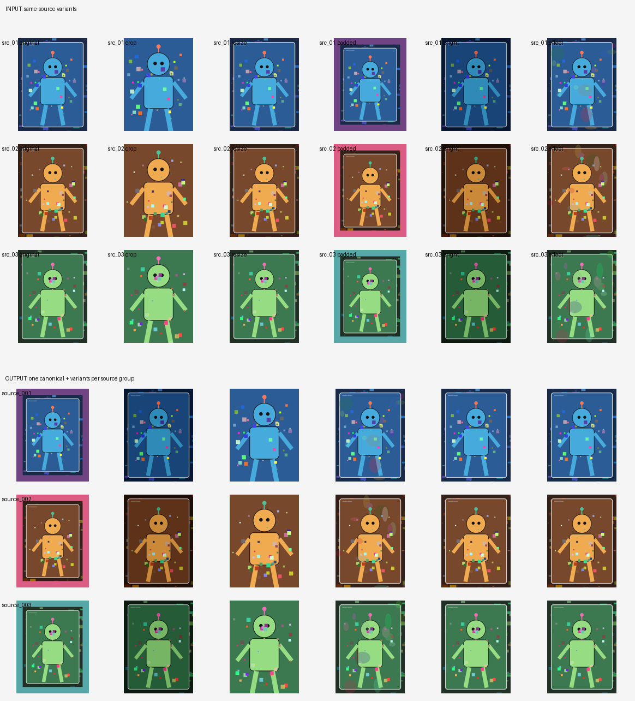

# FormCoreset

**Keep the information. Drop the duplicates.**

FormCoreset is a local-first CLI that removes **same-source image variants** —
crops, resizes, replaced backgrounds, effects, recompression — and keeps the most
complete canonical image per source. It can optionally stitch complementary
crops into a more complete image.

Built for character art, mascots, product shots, and other **non-face subjects**.
No uploads, no generative edits, originals are never modified.

> **Status: alpha.**
> `dedupe` is usable today. `extract` form clustering is experimental.
> Automatic identity filtering (picking the target subject from mixed search
> results) is not implemented yet.



*Synthetic demo: 18 crop/background/effect variants → 3 source groups. No
copyrighted images.*

## The problem

You download 100 images of the same character. Many are the same artwork with a
different background, crop, logo, or effect. Manual cleanup is slow and
inconsistent. Generic duplicate finders fail when backgrounds change; semantic
clustering groups different artworks with similar poses.

FormCoreset separates two problems:

1. **Same-source variants** → geometric dedupe (stable).
2. **Same-form, different artworks** → optional semantic clustering
   (experimental).

## What works today

- exact and near-duplicate detection;
- masked SIFT/ORB + ratio test + RANSAC homography;
- aligned-edge verification to reject false matches;
- complete/average/single linkage + singleton → medoid star merge;
- canonical per source, optional union-canvas stitching;
- contact sheet, report, and reproducible manifest;
- pluggable mask providers: `none`, `anime`, `general`, `auto`;
- experimental form library: DINOv2 + silhouette, or anime tag prior;
- GitHub Actions CI on Python 3.11/3.12.

## What does not work yet

- automatic identity filtering from mixed search results;
- reliable fine-grained pose/form clustering;
- 3D/UE5 export;
- full review UI (merge/split/canonical override);
- million-image scale (O(n²) pair matching);
- `export` is a stub.

## Install

Requires Python 3.11+ and [uv](https://docs.astral.sh/uv/).

```bash
git clone https://github.com/DameBr1An/form-coreset.git
cd form-coreset

# same-source dedupe for general subjects (rembg/BiRefNet)
uv sync --extra mask

# anime mask + WD14/CCIP prior
# uv sync --extra anime

# generic DINOv2 + silhouette form encoder
# uv sync --extra subject

# everything (heavy: torch, rembg, imgutils)
# uv sync --all-extras
```

| Extra | Adds |
|---|---|
| `subject` | timm + torch (DINOv2 + silhouette form encoder) |
| `mask` | rembg (BiRefNet / general mask) |
| `anime` | imgutils (anime-seg, WD14, CCIP) |
| `ui` | Gradio review UI |
| `all` | subject + mask + anime + ui |

## Quickstart

```bash
form-coreset dedupe ./downloads --out ./deduped
```

`dedupe` works on a folder that is **already one subject**. It will not decide
which character is the target.

```text
deduped/
  sources/
    source_001/
      canonical.png          # stitched or single best
      canonical_single.png   # always kept
      variants/
      source.json
    source_002/
  uncertain/
  contact_sheet.png
  report.md
  manifest.jsonl
  run.json
```

Tuning:

```bash
--linkage complete|average|single   # default: complete
--min-score 0.3
--star-threshold 0.2
--min-correlation 0.35
--no-mask --no-verify --no-stitch
```

Default behavior: `complete` linkage + star merge. false merges are considered
worse than conservative splits; singletons are surfaced for review.

## Experimental: form library

```bash
# generic non-face subjects: DINOv2 + silhouette
uv sync --extra subject
form-coreset extract ./deduped/sources/*/canonical.png --out ./forms

# optional anime prior: WD14 tags + CCIP
uv run form-coreset extract ./downloads --out ./forms --encoder anime-hybrid
```

No form names are produced: groups are `form_001`, `form_002`, … Human review is
required for fine-grained poses.

## Demo

```bash
uv run python examples/demo_dedupe.py
```

Generates synthetic posters only and writes `docs/assets/demo.png`.

## Scope

- **Stable:** same-source dedupe, canonical selection, stitching, manifests.
- **Experimental:** form clustering, anime tag prior.
- **Not in v0.1:** cloud service, automatic identity filtering, 3D export,
  generative edits, team collaboration.
- **Never by default:** uploads, telemetry, original deletion, generative edits.

## Design principles

- **Non-destructive:** originals are read-only; uncertain results are surfaced.
- **Local-first:** no upload; no telemetry; model weights downloaded separately.
- **Set-level:** optimize coverage + quality − redundancy, not per-image top-N.
- **Reproducible:** thresholds, model versions, and decisions in a manifest.
- **Pluggable:** mask providers, encoders, matchers, selectors, stitchers.

## Documentation

- [Product requirements](docs/PRD.md)
- [Pipeline architecture](docs/pipeline-architecture.md)
- [Same-source dedup logic](docs/same-source-logic.md)
- [Form-caption redundancy metric](docs/form-caption-redundancy.md)
- [Market research](docs/market-research.md)
- [Decision records](docs/decisions.md)
- [Release checklist](docs/release-checklist.md)

## Community

- [Contributing](CONTRIBUTING.md)
- [Code of Conduct](CODE_OF_CONDUCT.md)
- [Security Policy](SECURITY.md)
- [Changelog](CHANGELOG.md)
- [Issues](https://github.com/DameBr1An/form-coreset/issues)

## License

Code: [Apache-2.0](LICENSE) — an OSI-approved open-source license. See
[NOTICE](NOTICE) and [THIRD_PARTY_LICENSES.md](THIRD_PARTY_LICENSES.md).

Model weights are **not bundled**. Optional weights are downloaded separately
and may have their own terms (including non-commercial or territory-restricted
licenses). The default same-source dedupe path uses OpenCV SIFT/ORB and does not
require restricted weights.
